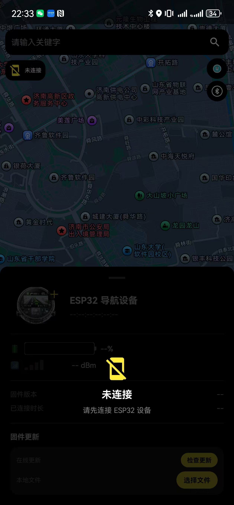
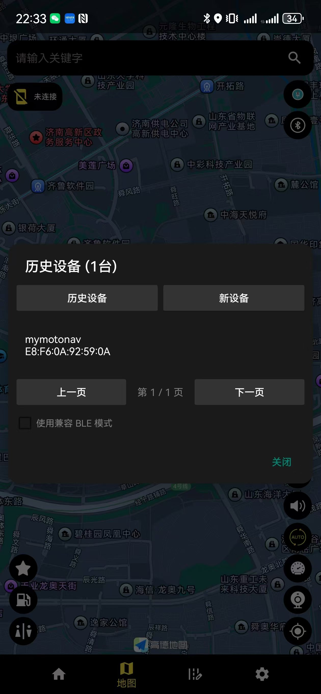
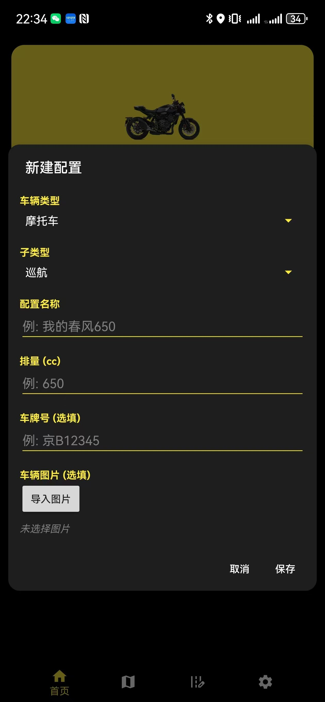
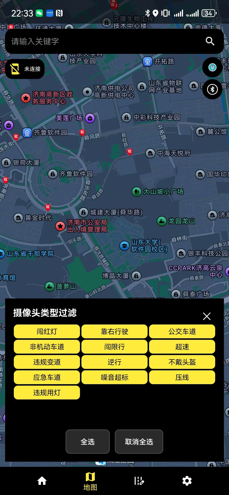
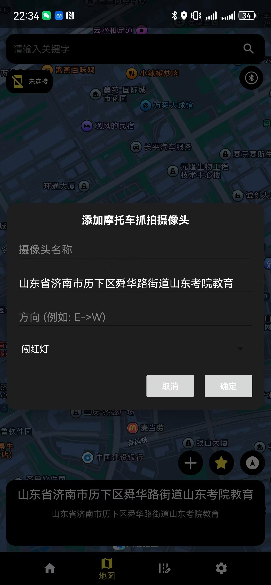
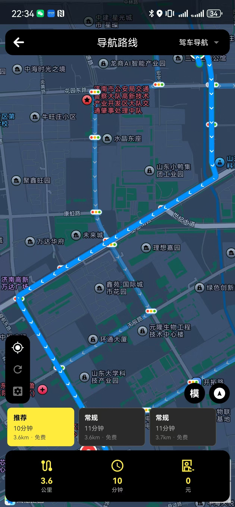
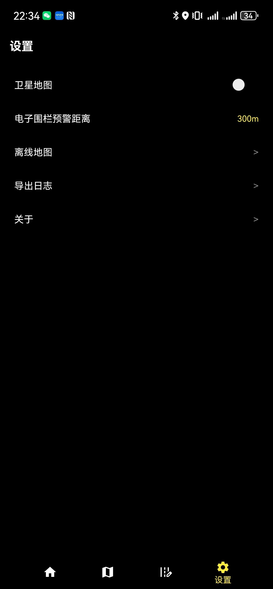
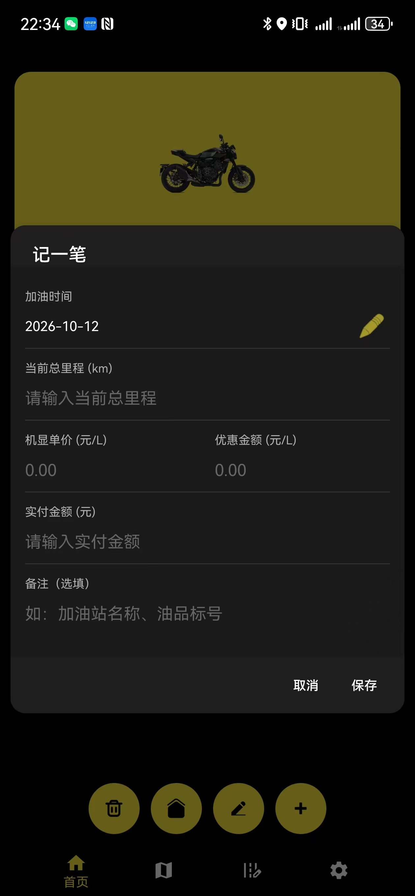
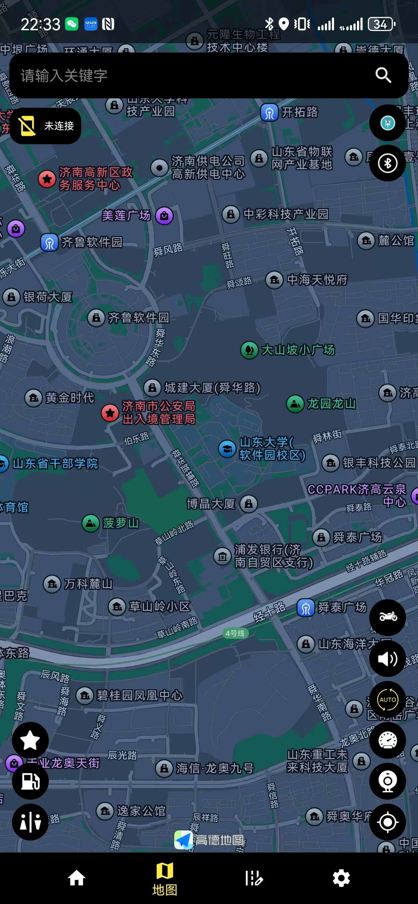

# MotoNav (Maps)

> 基于高德 / 腾讯双地图 SDK 的 Android 摩托车导航应用
> 包名 `org.zarroboogs.maps` · 版本 0.1.1 · minSdk 21 (Android 5.0) / targetSdk 30

---

## ⚠️ 开源版说明（先读）

本仓库为**功能裁剪的开源版本**，与完整版本存在以下差异：

| 项 | 说明 |
|---|---|
| BLE 设备连接 / 数据推送 / OTA | **实现未包含**。相关类保留为"空接口壳"以维持编译与 UI 完整，功能为空操作 |
| 预置数据（摄像头 / 路网） | **未包含**。摄像头 JSON 保留格式、内容为空（可按下方格式填充）；路网数据可由 `scripts/convert_roads.py` 生成 |
| 云端服务 | 地址与密钥为**占位符**（`Constants.java`），云同步需自建服务 |
| 签名密钥 | 不入库（`.gitignore` 已配置 `*.keystore` / `*.jks` 兜底） |
| 第三方 SDK 二进制 | 不入库（高德/腾讯 SDK 需按下方"构建步骤"自行获取） |

## 功能

- **双导航引擎**：高德地图（驾车 / 摩托 / 骑行 / 步行）+ 腾讯地图摩托车导航
- **摄像头预警**：地图标记、路线匹配、地理围栏接近提醒 + 系统 TTS 语音播报
- **巡航模式**：无目的地导航
- **离线地图**：省 / 市地图包下载管理
- **徒步模式**：GPX 轨迹导航
- **轨迹历史 / 车辆管理 / 油耗统计**
- **设置中心**：地图样式、播报模式、围栏开关等

## 截图

<table>
  <tr>
    <td></td>
    <td></td>
    <td></td>
  </tr>
  <tr>
    <td></td>
    <td></td>
    <td></td>
  </tr>
  <tr>
    <td></td>
    <td></td>
    <td></td>
  </tr>
  <tr>
    <td></td>
    <td></td>
    <td></td>
  </tr>
</table>

## 技术栈

| 类别 | 技术 |
|------|------|
| 语言 | Java + Kotlin |
| 构建 | Gradle 7.0.2 + Android Gradle Plugin 7.0.0（JDK 11+） |
| 地图 SDK | 高德 3D地图 / Navi / Search / Location 11.1.200（2026-04-21 整合包） |
| 数据库 | Room |
| 模块划分 | `app`（主应用）/ `nav-core`（核心库）/ `nav-hiking`（徒步） |
| ABI | armeabi-v7a, arm64-v8a |
| 坐标系 | 以 GCJ-02 为主，`LatLngUtils` 提供 BD-09 / GCJ-02 / WGS-84 互转 |

## 目录结构

```
Maps-master/
├── app/                                # 主应用（Java + Kotlin 混合）
│   └── src/main/
│       ├── java/org/zarroboogs/maps/   # 主界面、MVP、摄像头、巡航、BLE 空壳
│       ├── kotlin/org/zarroboogs/maps/ # 导航 UI（含腾讯）、徒步/轨迹/车辆、数据层(Room)、hub 壳
│       ├── assets/                     # 摄像头 JSON（空结构）+ 路网分片 roads_bin/
│       └── res/
├── nav-core/                           # 核心库：路线引擎 / 路网 / 导航数据模型
├── nav-hiking/                         # 徒步模块：GPX 导航
├── scripts/                            # 路网数据转换脚本（GeoJSON → Geohash .bin）
├── gradle/ + gradlew / gradlew.bat     # Gradle Wrapper 7.0.2
└── LICENSE                             # GPL-3.0
```

## 构建步骤

> 下述 SDK 与数据文件均**不在仓库中**（已被 `.gitignore` 忽略），需自行获取。

**1. 环境**：JDK 11+，Android SDK（compileSdk 30）

**2. 放入高德 SDK**（[开放平台](https://lbs.amap.com) 下载"3D地图+导航+搜索+定位"整合包）：

- jar → `app/libs/AMap3DMap_AMapNavi_AMapSearch_AMapLocation/` 目录下
  （文件名以 `app/build.gradle` 中 `files('libs/...')` 引用为准）
- so → `app/src/main/jniLibs/{arm64-v8a,armeabi-v7a}/`

**3. 申请并替换 Key 占位符**：

| Key | 位置 | 申请地址 |
|---|---|---|
| 高德 | `AndroidManifest.xml` → `YOUR_AMAP_KEY` | https://lbs.amap.com（需绑定包名 + 签名 SHA1） |
| 腾讯 | `AndroidManifest.xml` → `YOUR_TENCENT_KEY` | https://lbs.qq.com（需绑定包名 + 签名 SHA1） |
| 云同步（可选） | `Constants.java` → `YOUR_SERVER` / `YOUR_API_KEY` | 自建服务 |

**4. （可选）填充摄像头数据**：按下方格式编辑 `app/src/main/assets/motorcycle_cameras.json`

**5. 编译**：

```bash
./gradlew assembleDebug     # 编译 Debug APK
./gradlew installDebug      # 安装到设备
```

## 摄像头数据格式

`app/src/main/assets/motorcycle_cameras.json`（首次安装且无网络时导入本地库；有网络时可由自建云同步服务下发）：

```json
{
  "result": "OK",
  "hint": "",
  "data": [
    {
      "id": 1,
      "name": "路口名称",
      "address": "地址描述",
      "latitude": 36.643228,
      "longtitude": 117.120216,
      "direction": "E->W",
      "note": "备注"
    }
  ]
}
```

> ⚠️ 字段名 `longtitude` 为既有实现的拼写，**请保持一致**，否则解析失败。

## 路网数据（可选）

路网数据（Geohash-5 分片二进制 `.bin`）未包含在仓库中；可用 `scripts/convert_roads.py` 从自备 GeoJSON 源生成后放入 `app/src/main/assets/roads_bin/`，格式说明见脚本头部注释。

## 许可

本项目采用 **GPL-3.0** 许可，详见 [LICENSE](LICENSE)。

## 免责声明

- 本项目仅供学习交流使用，摄像头 / 路网等数据的采集与使用请遵守所在地法律法规
- 接入高德 / 腾讯等第三方地图服务须遵守其各自的服务条款
- 导航与预警信息仅供参考，行车请以实际路况为准，注意安全
